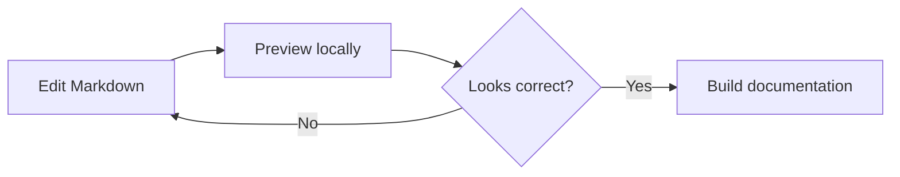

# 10. Advanced Features & MkDocs Integration

Combine Markdown and extensions to explain workflows, provide alternative
instructions, and organise a growing documentation website.

## Draw a Mermaid diagram

Mermaid turns a text description into a diagram. Use a `mermaid` fenced block:

````markdown

````


`LR` lays out the flow from left to right. Brackets define boxes, braces define
decisions, and arrows connect nodes. Include a prose description too: edit a
page, preview it, revise it if needed, then build the documentation.

This project's SuperFences entry includes a custom fence:

```yaml
markdown_extensions:
  - pymdownx.superfences:
      custom_fences:
        - name: mermaid
          class: mermaid
          format: !!python/name:pymdownx.superfences.fence_code_format
```

Material recognises the fence and initialises Mermaid in the browser, so this
setup needs no separate Mermaid plugin or `extra_javascript` entry. See the
[Material diagrams reference](https://squidfunk.github.io/mkdocs-material/reference/diagrams/).

## Group alternatives with tabs

Use tabs for equivalent instructions. Start each with `===` and a quoted label,
then indent its content four spaces:

````markdown
=== "uv"

    ```bash
    uv run mkdocs serve
    ```

=== "Activated environment"

    ```bash
    mkdocs serve
    ```
````

=== "uv"

    ```bash
    uv run mkdocs serve
    ```

=== "Activated environment"

    ```bash
    mkdocs serve
    ```

The second command assumes an activated environment containing the project's
dependencies. Keep sequential steps outside tabs so readers do not miss a
required action in another panel.

Enable tabs with:

```yaml
markdown_extensions:
  - pymdownx.superfences
  - pymdownx.tabbed:
      alternate_style: true
```

Merge these settings into the existing extension list, retaining the Mermaid
options on the single SuperFences entry. See the
[Material content-tabs reference](https://squidfunk.github.io/mkdocs-material/reference/content-tabs/).

## Cross-reference pages and headings

Use a relative `.md` path, optionally followed by a heading anchor:

```markdown
[Formatting guide](text-formatting.md)
[Table alignment](tables.md#align-columns)
[Return to the diagram](#draw-a-mermaid-diagram)
```

- [Formatting guide](text-formatting.md)
- [Table alignment](tables.md#align-columns)
- [Return to the diagram](#draw-a-mermaid-diagram)

For headings whose wording may change, use an explicit stable ID with `attr_list`:

```markdown
### A stable destination { #stable-destination }

[Link to this section](#stable-destination)
```

### A stable destination { #stable-destination }

[Link to this section](#stable-destination).

These are ordinary page and section links. Automatic API-object references or
numbered figure references require additional tooling beyond this setup.

## Control the table of contents

The `toc` extension builds the heading outline and can add permalinks:

```yaml
markdown_extensions:
  - toc:
      permalink: true
```

Material displays the outline in its page navigation. For an additional table
of contents inside the page body, put `[TOC]` on its own line. You usually do not
need both. To hide Material's table of contents on a page, put this YAML front
matter at the very top of that page:

```yaml
---
hide:
  - toc
---
```

## Organise site navigation

`nav` controls page order, labels, and grouping. Paths are relative to `docs/`:

```yaml
nav:
  - Home: index.md
  - Markdown tutorials:
      - Overview: markdown/index.md
      - Headings: markdown/headings.md
      - Advanced features: markdown/advanced.md
```

This is a shortened example; the actual configuration lists every lesson. Add
a page to `nav` when you want it in the menu. Adding headings only changes the
outline of that page.

## Know which component provides a feature

| Feature | Configuration or component |
| :--- | :--- |
| Heading outline and permalinks | `toc` |
| Tables | `tables` |
| Image widths and custom heading IDs | `attr_list` |
| Strikethrough | `pymdownx.tilde` |
| Task checkboxes | `pymdownx.tasklist` |
| Code highlighting | `pymdownx.highlight` and Pygments |
| Nested code and Mermaid fences | `pymdownx.superfences` |
| Tabs | `pymdownx.tabbed` |
| Maths | `pymdownx.arithmatex` and MathJax |
| Callouts and collapsible sections | `admonition` and `pymdownx.details` |
| Search | MkDocs `search` plugin |
| Navigation, copy buttons, and styling | Material theme |

Install this project's dependencies with `uv sync`. For a separate project,
`uv add mkdocs mkdocs-material` installs MkDocs, Material, and the PyMdown
Extensions dependency used by these examples. Extensions belong under
`markdown_extensions`; plugins and theme features use their own configuration keys.

## Preview and validate

Run from the repository root:

```bash
uv run mkdocs serve
```

Inspect tabs, callouts, links, navigation, and diagrams. Then stop the server
with **Ctrl+C** and build:

```bash
uv run mkdocs build --strict
```

A clean build checks site generation and reports missing documentation targets.
It does not execute JavaScript, so also check MathJax and Mermaid in a browser
with access to their external scripts.

## Try it

Create a workflow page with a Mermaid diagram, a pair of tabs, and a link to
another lesson. Add it to `nav`, inspect its table of contents, and run a strict
build. Explain which extension provides each feature.

[Return to the tutorial overview](index.md).
